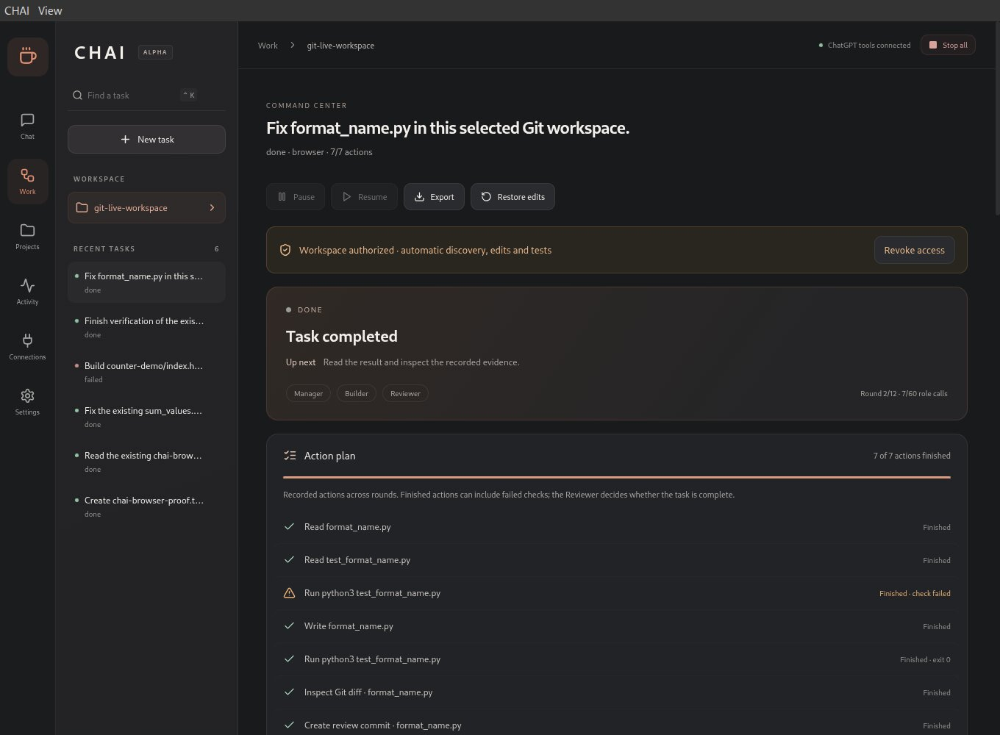

<div align="center">
  
  <h1>CHAI</h1>
  <p><strong>Chat Has Actions Inside.</strong><br/>Stop chatting. Start doing.</p>
  <p>A Linux desktop workspace where your ChatGPT conversations<br/>plan tasks, use scoped tools and review the results.</p>
  <p>
    <a href="https://github.com/harshitethic/CHAI/actions/workflows/ci.yml"></a>
    <a href="LICENSE"></a>
    
    
  </p>
  <p><a href="https://github.com/harshitethic/CHAI/releases/tag/v0.6.0-alpha.1"><strong>Download 0.6 alpha</strong></a> · <a href="#get-started">Get started</a> · <a href="docs/PRIVACY.md">Privacy</a> · <a href="docs/IMPLEMENTATION.md">Architecture</a></p>
</div>



*Actual CHAI interface displaying a completed live ChatGPT task. The original failed test remains visible beside the successful rerun. This is recorded execution evidence.*

## Follow the work

Give CHAI a goal and a dedicated project folder. Its Manager assigns work, the Builder proposes concrete actions, and the Reviewer checks captured evidence. You can see what is happening, what finished and what remains.

**New in 0.6:** a current-action panel, next step, persistent action checklist and readable activity feed. Expand any update for the exact evidence, or open the detailed role logs. Paused work, failed checks and unfinished review have distinct states. A full action bar means the actions finished; the task reaches DONE only after its verification flow.

| What you see | What it comes from |
| --- | --- |
| Current action and next step | Saved task phase and execution cursor |
| Finished / active / pending checklist | The validated tool plan and durable effects |
| Test failures and successful reruns | Actual exit codes and termination evidence |
| Manager, Builder and Reviewer updates | Structured responses returned through the authenticated tool connection |
| Final result and limitations | Independent review and the Manager's report |

## What CHAI can do

- **Work on selected files.** Read, list, search, create directories and edit text, with conflict checks and recorded before-edit snapshots.
- **Run checks.** Execute Python, Node or Bash using explicit file snapshots inside an offline Bubblewrap sandbox.
- **Inspect and commit changes.** Preview a selected-file Git diff and, after native confirmation, create a local review-branch commit while preserving your current branch and staging index.
- **Use a scoped browser.** Preview project pages, visit explicitly allowed HTTPS origins, interact with observed controls and capture screenshots.
- **Use a selected X11 window.** Observe and send bounded input to a separately authorized application window.
- **Keep the work.** Save plans, effects, role responses and history in SQLite. Pause, revoke access, stop execution, inspect errors and resume supported checkpoints.

Normal signed-in **ChatGPT with 6 High** is the tested reasoning provider. Each role keeps its conversation. CHAI sends job references through the visible composer; the installed CHAI Desktop MCP plugin retrieves context and returns validated results. The application does not extract ChatGPT cookies or assistant text.

## Proof from real runs

| Workflow | Observed result | Evidence |
| --- | --- | --- |
| Repair a Python function | Original failures → code fix → unchanged tests pass | [Live repair](docs/qa/autonomous-live-2026-10-19.json) |
| Verify a browser counter | Node test passes; actual clicks produce **0 → 1 → 2 → 0** | [Browser run](docs/qa/computer-live-2026-10-19.json) |
| Make a review commit | Failing test → one-file fix → passing test → confirmed commit; HEAD and staging unchanged | [Git run](docs/qa/git-live-2026-10-19.json) |
| Pause and restart | Saved history retained; ambiguous interrupted actions are not blindly repeated | [QA notes](docs/QA_PROGRESS_2026-10-19.md) |

The Git run completed in **two rounds and seven role calls**, with one workspace grant and one native Git confirmation. Separate ChatGPT approval prompts still applied.

**54 automated tests** cover the core workflows and boundaries. Native Electron tests cover actual files, sandbox execution, browser previews, Git confirmation, progress display, pause/reload/error behavior and four window widths. Release CI also tests the packaged executable. Scripted tests and live ChatGPT runs are recorded separately.

## Get started

### 1. Install on Linux

Download the AppImage and `SHA256SUMS` from the [release](https://github.com/harshitethic/CHAI/releases/tag/v0.6.0-alpha.1). A Debian amd64 package is also available.

Required: Python 3, Bubblewrap and Git. Sandboxed Node execution requires `/usr/bin/node`; selected-window control also requires `xdotool`, `x11-utils` and X11.

```sh
sha256sum --check --ignore-missing SHA256SUMS
chmod +x CHAI-0.6.0-alpha.1.AppImage
APPIMAGE_EXTRACT_AND_RUN=1 ./CHAI-0.6.0-alpha.1.AppImage
```

For a user-only installation from a source checkout:

```sh
sh scripts/install-local.sh /path/to/CHAI-0.6.0-alpha.1.AppImage 0.6.0-alpha.1
# Add --upgrade when replacing an existing CHAI installation.
```

### 2. Connect your ChatGPT conversations

1. In **Connections**, start the tool connection.
2. Provide an HTTPS origin forwarded to loopback port **40671**, or use the temporary Cloudflare tunnel option. Temporary URLs change when recreated.
3. Add the displayed MCP URL through **ChatGPT Plugins → Add custom MCP server**, choose OAuth and create **CHAI Desktop**.
4. Approve CHAI's local pairing prompt.
5. Open Manager, Builder and Reviewer, select **6 High**, and enable CHAI Desktop in each conversation.

Pairing authorizes CHAI's PC tools. Your ChatGPT account, available models, permission prompts and service limits remain independent.

### 3. Start with a dedicated workspace

Choose a project folder and **Autonomous in this workspace**, or **Review each plan**. Browser and selected-window permissions are separate options. Git commits retain a native exact-patch confirmation.

An example goal:

> Inspect calculator.py and its existing test. Run the test, fix only the implementation, rerun the unchanged test and explain the result. Show a selected-file Git diff before requesting a review commit.

The folder and files must exist. Sandbox scripts that import sibling Python modules need `/workspace` on `sys.path`.

## Boundaries that matter

CHAI is a working alpha with a deliberately bounded tool set. It is not a drop-in replacement for every ChatGPT Work or Codex workflow.

| Area | Current boundary |
| --- | --- |
| Host development | No unrestricted host shell, package installation or network-enabled test environment |
| Git | Existing repository with an initial commit and its own real `.git` directory; up to 12 selected regular text files totaling 24 KB; no push, checkout, deletion, merge or signing |
| Computer control | Isolated browser origins and a selected X11 window; no arbitrary whole-desktop or Wayland control |
| Long tasks | Workspace mode: up to 12 rounds, 60 role calls and 144 actions; review mode: 3 rounds, 15 calls and 36 actions |
| Recovery | App restart pauses unfinished tasks; Resume reconciles checkpoints. Browser targets are ephemeral and ambiguous actions require inspection |
| Startup | No unattended app startup; whole-PC reboot acceptance remains unverified |
| Progress | Shows known actions and recorded updates; future repair rounds can add work. No invented completion percentage or ETA |

Selected files, goals, patches, tool outputs and authorized screenshots are shared with your signed-in ChatGPT conversations. Local task data has private file permissions but is **not encrypted**. Read [privacy](docs/PRIVACY.md) and [security](docs/SECURITY.md) before granting access.

## Build and contribute

Requires modern Node.js/npm and the Linux dependencies above.

```sh
npm ci
npm run check
xvfb-run -a npm run test:e2e
xvfb-run -a npm run test:computer
xvfb-run -a npm run test:crash
npm start
npm run package
```

On Ubuntu systems that restrict unprivileged user namespaces, Bubblewrap can fail with `RTM_NEWADDR: Operation not permitted`. CHAI fails closed. An administrator should review the host's Bubblewrap/AppArmor profile; the app does not weaken system policy automatically.

Read [handoff.md](handoff.md) for the latest verified state, [tasks.md](tasks.md) for the backlog and [CONTRIBUTING.md](CONTRIBUTING.md) for contribution guidance. Keep changes scoped and attach real validation evidence. Never commit private `.qa` files, task databases, browser profiles or tunnel credentials.

## Project notes

[Architecture](docs/IMPLEMENTATION.md) · [Release notes](docs/RELEASE_BROWSER_ALPHA.md) · [Kali runbook](docs/KALI_RUNBOOK.md) · [Decisions](decisions.md) · [Remaining gates](blockers.md) · [Security reporting](SECURITY.md)

Released under the [MIT license](LICENSE). ChatGPT is an OpenAI product; CHAI is an independent project.
