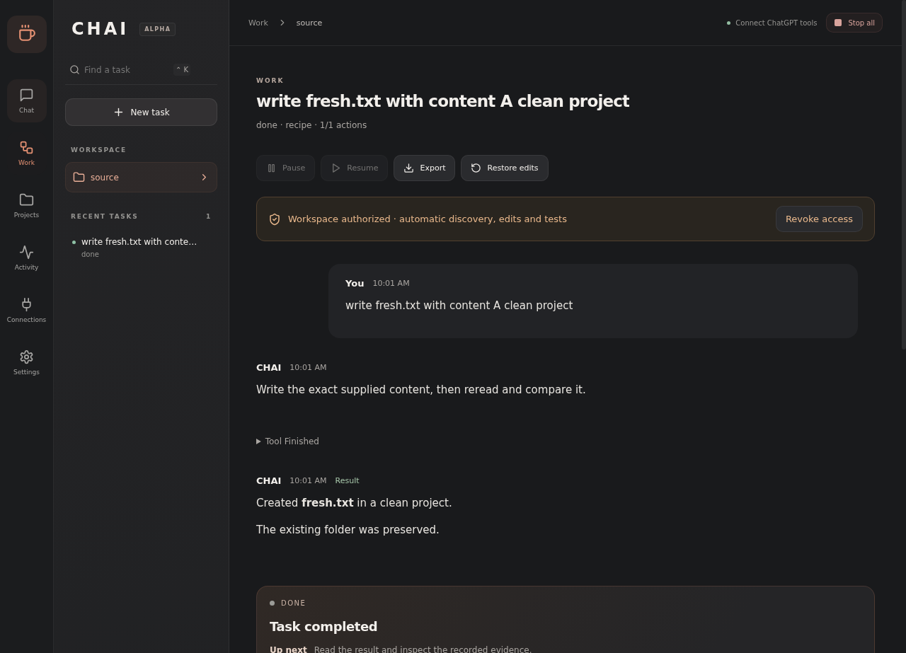
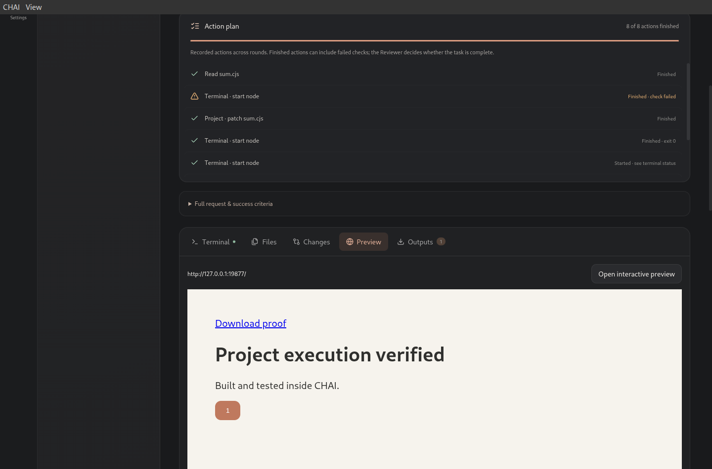

<div align="center">
  
  <h1>CHAI</h1>
  <p><strong>Chat Has Actions Inside.</strong><br/>Stop chatting. Start doing.</p>
  <p>A Linux desktop workspace where your ChatGPT conversations<br/>plan tasks, use scoped tools and review the results.</p>
  <p>
    <a href="https://github.com/harshitethic/CHAI/actions/workflows/ci.yml"></a>
    <a href="LICENSE"></a>
    
    
  </p>
  <p><a href="https://github.com/harshitethic/CHAI/releases/tag/v0.10.0-alpha.1"><strong>Download 0.10 alpha</strong></a> · <a href="#get-started">Get started</a> · <a href="docs/PRIVACY.md">Privacy</a> · <a href="docs/IMPLEMENTATION.md">Architecture</a></p>
</div>



*Actual native CHAI 0.9 interface. This screenshot uses an explicit scripted conversation fixture to test rendering and persistence; it is not presented as a live model response.*

## Follow the work

Give CHAI a goal. Start a new empty project or explicitly select an existing folder. Its Manager assigns work, the Builder proposes concrete actions, and the Reviewer checks captured evidence. You can see what is happening, what finished and what remains.

**New in 0.10:** live public updates and a persistent milestone plan from the active ChatGPT job. Follow-ups queue at safe execution boundaries by default, preserving the current action and running preview. Choose **Interrupt current work** when you need an immediate stop. Original requirements stay primary when you say “continue.”

The milestone plan tells you what CHAI reports as done, active, pending or blocked. The action history independently records what tools actually did. Plans cannot grant permissions or mark a task complete. Stale role jobs cannot overwrite progress after a follow-up; repeated delivery of the same update is idempotent.

See the [workflow acceptance contract](docs/WORKFLOW.md) for the behavior we are building, the tests behind it, and the remaining gaps.

Project commands, network and local browser previews start enabled in the new-task UI; you can turn each off before sending. Host commands remain a separate native grant. Existing tasks retain their original permissions. A waiting indicator shows when a ChatGPT reply has not arrived and opens the relevant conversation directly.

The agent instructions now request concise, natural progress messages and review the user's full outcome rather than only a smaller implementation assignment. These are tested workflow changes, **not a claim of first-party Codex/Work parity**. Progress arrives when ChatGPT calls the progress tool; it is not token-by-token streaming. Older conversations may need their CHAI plugin tool list refreshed to expose the new tool.

The workspace includes isolated writable projects, dependency installation, persistent command sessions, interactive local-app previews, follow-up steering, project diffs, document outputs and authenticated app tools. The Work screen keeps the current action, next step, check results and role updates alongside the actual working environment.



*Native Linux capture from the integration fixture: the failed command stays visible, its rerun passes, and the embedded app responds to a real input event. This screenshot is a scripted integration test, not a claimed live ChatGPT run.*

| What you see | What it comes from |
| --- | --- |
| Current action and next step | Saved task phase and execution cursor |
| Milestones: completed / active / pending / blocked | Persisted updates from the assigned ChatGPT job; reported assessments, not execution proof |
| Finished / active / pending action checklist | The validated tool plan and durable effects |
| Test failures and successful reruns | Actual exit codes and termination evidence |
| Live conversation updates | Authenticated `chai_report_progress` calls during the current job |
| Manager, Builder and Reviewer results | Structured responses returned through the authenticated tool connection |
| Final result and limitations | Independent review and the Manager's report |

## What CHAI can do

| Capability | In the app |
| --- | --- |
| Project execution | Copy a dedicated project into a private, independent Git checkout; run Node, Python, Bash and package managers in Bubblewrap. Optional network access enables dependencies and local servers. |
| Terminals | Run manual or agent commands, stream output, send stdin and stop processes. Opt-in durable sessions survive app exit/crash and reconnect without replay. |
| Browser verification | Open an owned local server or authorized website, inspect controls/screenshots/errors and act on observed targets. Local apps have an interactive embedded preview. |
| Task steering | Queue a follow-up after the current planning/action/review step, or explicitly interrupt. Supersede unstarted actions, preserve completed evidence and keep previews running when queued. |
| Repository context | Paginated file discovery and reads, scoped source search, exact-match patches with SHA256 conflict checks, project instructions and bounded context compaction. |
| Git workflow | Inspect changes side by side, create branches and confirmed commits in the working copy, inspect GitHub CI and publish a confirmed draft PR when GitHub CLI is authenticated. The original checkout and index remain separate. |
| Background work | Opt-in tray continuation, task notifications and login startup. Safe checkpoint recovery can resume authorized work; uncertain actions are never automatically replayed. |
| Documents and apps | Generate PDF, DOCX, XLSX and PPTX files, register other outputs, save/open deliverables and use authorized HTTPS MCP connections with OAuth sign-in or encrypted bearer credentials. |
| Computer interaction | Scoped browser uploads/downloads, X11 window input/scrolling and AT-SPI inspection; Wayland portal capture and input after native sharing consent. |

CHAI's three roles still use normal signed-in ChatGPT conversations with **6 High**. The tool connection uses OAuth to protect CHAI's tools; it is not a model-inference API. App connectors are a separate feature and do not inherit credentials from ChatGPT's plugins.

See the [0.9 conversation and retry verification](docs/QA_CONVERSATION_2026-10-20.md), including a real ChatGPT reply with zero tool actions and public-binary installation checks.

See the [0.8 runtime verification](docs/QA_RUNTIME_2026-10-20.md) for host execution, OAuth, Wayland and crash-recovery checks.

## Proof from real runs

| Workflow | Observed result | Evidence |
| --- | --- | --- |
| Install, repair and preview a project | npm install → unchanged test fails → one-file repair → same test passes → background server → browser 0 → 1 → registered output | [Live project run](docs/qa/project-live-2026-10-19.json) |
| Add a deliverable to the same task | Follow-up creates and registers a real PDF from prior evidence; one round, four role calls | [Live PDF follow-up](docs/qa/followup-document-live-2026-10-19.json) |
| Repair a Python function | Original failures → code fix → unchanged tests pass | [Live repair](docs/qa/autonomous-live-2026-10-19.json) |
| Verify a browser counter | Node test passes; actual clicks produce **0 → 1 → 2 → 0** | [Browser run](docs/qa/computer-live-2026-10-19.json) |
| Make a review commit | Failing test → one-file fix → passing test → confirmed commit; HEAD and staging unchanged | [Git run](docs/qa/git-live-2026-10-19.json) |
| Pause and restart | Saved history retained; ambiguous interrupted actions are not blindly repeated | [QA notes](docs/QA_PROGRESS_2026-10-19.md) |

The Git run completed in **two rounds and seven role calls**, with one workspace grant and one native Git confirmation. Separate ChatGPT approval prompts still applied.

Automated tests cover the core workflows and boundaries. Native Electron tests cover actual files, sandbox execution, browser previews, Git confirmation, progress display, pause/reload/error behavior and four window widths. Release CI also tests the packaged executable. Scripted tests and live ChatGPT runs are recorded separately.

## Get started

### 1. Install on Linux

Download the AppImage and `SHA256SUMS` from the [release](https://github.com/harshitethic/CHAI/releases/tag/v0.10.0-alpha.1). A Debian amd64 package is also available.

Required: Python 3 with venv support, Bubblewrap, Git, Node and npm. X11 control requires `xdotool`, `x11-utils`, Python GI and the AT-SPI typelib. Wayland control requires a working RemoteDesktop/ScreenCast portal backend (GNOME or KDE), PipeWire, Python GI/GStreamer and the PipeWire/base/good GStreamer plugins. Document libraries install inside the task project when network access is authorized. GitHub publication additionally requires `gh auth login` on this machine.

```sh
sha256sum --check --ignore-missing SHA256SUMS
chmod +x CHAI-0.10.0-alpha.1.AppImage
APPIMAGE_EXTRACT_AND_RUN=1 ./CHAI-0.10.0-alpha.1.AppImage
```

For a user-only installation from a source checkout:

```sh
sh scripts/install-local.sh /path/to/CHAI-0.10.0-alpha.1.AppImage 0.10.0-alpha.1
# Add --upgrade when replacing an existing CHAI installation.
```

### 2. Connect your ChatGPT conversations

1. In **Connections**, start the tool connection.
2. Provide an HTTPS origin forwarded to loopback port **40671**, or use the temporary Cloudflare tunnel option. Temporary URLs change when recreated.
3. Add the displayed MCP URL through **ChatGPT Plugins → Add custom MCP server**, choose OAuth and create **CHAI Desktop**.
4. Approve CHAI's local pairing prompt.
5. Open Manager, Builder and Reviewer, select **6 High**, and enable CHAI Desktop in each conversation.

Pairing authorizes CHAI's PC tools. Your ChatGPT account, available models, permission prompts and service limits remain independent.

### 3. Start with a dedicated workspace

Choose a project folder and **Autonomous in this workspace**, or **Review each plan**. Expand **Project, browser and app access**:

- Enable **Build in an isolated project copy** for normal development commands.
- Enable network when the task needs dependency downloads or a development server. This permits network access from project processes, including local services.
- Enable **Allow host commands** only for tasks that need your installed tools or files outside the isolated copy. CHAI confirms the grant natively.
- Enable **Keep terminal commands running when CHAI closes** to reconnect to commands after app restart. Use Stop or Revoke to end them.
- Choose the extended workspace budget for longer tasks.
- Enable the browser for verification. Choose any external HTTPS origins explicitly.
- Select only the app connections and desktop window needed for this task.

Git commits and external app actions retain native confirmation. Under Settings, tray continuation and login startup are separate opt-ins.

An example goal:

> Install this project’s dependencies, reproduce the failing test, fix the implementation and rerun the same test. Start the app on 127.0.0.1, inspect it in the browser and show the changes. Create a draft PR only after I confirm the diff and destination.

The folder and files must exist. Sandbox scripts that import sibling Python modules need `/workspace` on `sys.path`.

## Boundaries that matter

CHAI is a working alpha with a deliberately bounded tool set. It is not a drop-in replacement for every ChatGPT Work or Codex workflow.

Choose the capabilities each task needs. The Work screen shows the current role, next action, completed and pending steps, terminal results, file changes and outputs. Provider sign-in and permissions remain visible when work needs attention.

| Area | Current boundary |
| --- | --- |
| Execution | Linux Bubblewrap; writable isolated project, clean environment, no host home/browser credentials. Network is an explicit project grant. Optional host commands run as your OS account outside Bubblewrap after native task authorization. |
| Project size | Up to 20,000 copied source files / 250 MB; common credentials, symlinks, hardlinks, dependencies and build caches excluded. Install dependencies in the copy. |
| Git | Independent checkouts preserve source history. GitHub PR/CI requires authenticated local GitHub CLI and a GitHub source origin. No automatic merge, force-push or credential migration. Legacy selected-file Git tools keep their narrower limits. |
| App connections | HTTPS Streamable HTTP MCP with OAuth discovery, PKCE, dynamic registration or a pre-registered public client, encrypted credentials and token refresh; bearer authentication remains available. Every remote tool invocation is confirmed. Provider-specific registration may still be required. |
| Computer control | Selected X11 window or a source selected in the Wayland sharing portal. Wayland capture/input needs a compatible portal backend; X11 accessibility depends on the target app. |
| Long tasks | Per follow-up: workspace mode allows 12 rounds / 60 role calls / 144 new actions; extended workspace mode allows 50 / 250 / 600; review mode allows 3 / 15 / 36. Six concurrent processes maximum, up to two hours per command. |
| Recovery | Closing to tray preserves execution. Opt-in durable commands survive app exit/crash, retain output and reconnect by session identity. Computer reboot ends commands. Uncertain external actions require inspection. ChatGPT sign-in, prompts and service limits still apply. |
| Deliverables | Basic document layouts plus general project-generated files. Creation and output hashes are checked; arbitrary layout quality is not guaranteed. |
| Progress | Known actions and recorded evidence, with no invented overall percentage, hidden reasoning or ETA. Whole-PC reboot acceptance remains unverified. |

Selected files, goals, patches, tool outputs and authorized screenshots are shared with your signed-in ChatGPT conversations. Local task data has private file permissions but is **not encrypted**. Read [privacy](docs/PRIVACY.md) and [security](docs/SECURITY.md) before granting access.

## Build and contribute

Requires modern Node.js/npm and the Linux dependencies above.

```sh
npm ci
npm run check
npm run test:workspace
npm run test:connectors
npm run test:oauth
# Optional network-backed document generation check:
npm run test:documents
xvfb-run -a npm run test:e2e
xvfb-run -a npm run test:computer
xvfb-run -a npm run test:crash
npm start
npm run package
```

On Ubuntu systems that restrict unprivileged user namespaces, Bubblewrap can fail with `RTM_NEWADDR: Operation not permitted`. CHAI fails closed. An administrator should review the host's Bubblewrap/AppArmor profile; the app does not weaken system policy automatically.

Read [handoff.md](handoff.md) for the latest verified state, [tasks.md](tasks.md) for the backlog and [CONTRIBUTING.md](CONTRIBUTING.md) for contribution guidance. Keep changes scoped and attach real validation evidence. Never commit private `.qa` files, task databases, browser profiles or tunnel credentials.

## Project notes

[Architecture](docs/IMPLEMENTATION.md) · [Release notes](docs/RELEASE_BROWSER_ALPHA.md) · [Kali runbook](docs/KALI_RUNBOOK.md) · [Decisions](decisions.md) · [Remaining gates](blockers.md) · [Security reporting](SECURITY.md)

Released under the [MIT license](LICENSE). ChatGPT is an OpenAI product; CHAI is an independent project.
