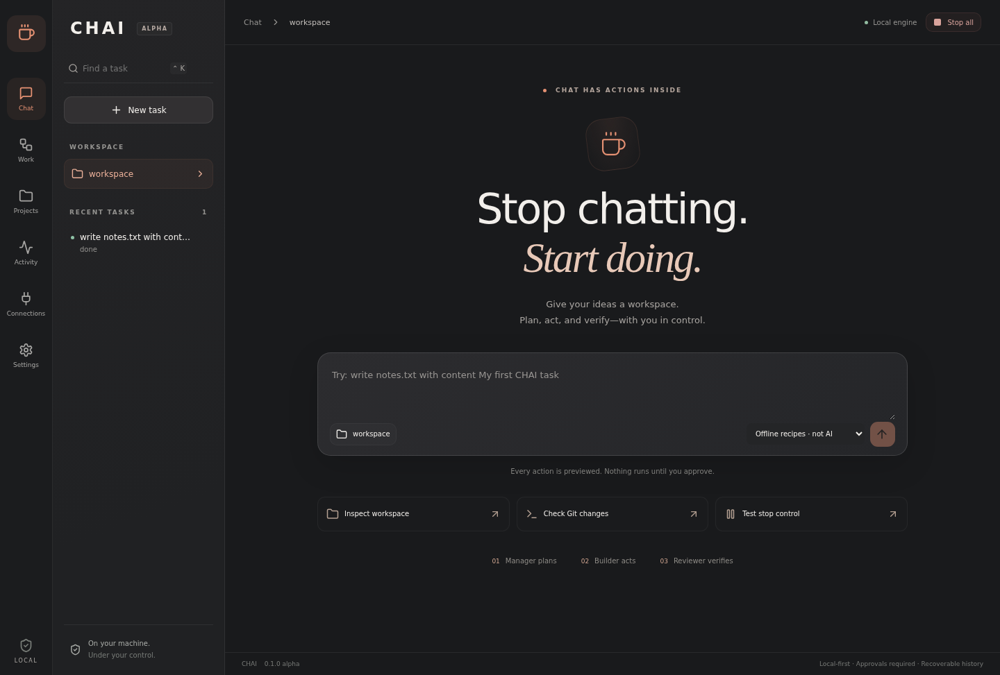

# CHAI — Chat Has Actions Inside

**Stop chatting. Start doing.**



A local-first Electron desktop workspace for Linux: preview a plan, approve real file or terminal actions, and inspect the evidence in three role panels.

> **Development alpha.** ChatGPT is interactive/manual only. Opening three views does not create API access or bypass service limits. Offline recipes are deterministic; the reviewer checks recorded evidence, not general semantic correctness. See `handoff.md` for the exact verified build status.

## What is implemented

- Original charcoal/coral React interface with task history, workspace picker, three role timelines, approvals, activity and provider settings.
- SQLite WAL task state, explicit checkpoints, serial execution, approval expiry, pause/resume and process-group cancellation.
- Descriptor-relative Python file gateway: no symlinks, hardlinks, traversal, special files or common credential paths. Atomic edits with snapshots and conflict-aware restoration.
- Terminal allowlist: working directory, Git status/diff summary, Node version and cancellable sleep. No arbitrary shell or privileged commands.
- ChatGPT windows with an isolated shared Chromium partition, manual sign-in and no credential extraction. Structured JSON handoff to local execution.
- Optional Ollama plan generation at localhost. An installed model is required; no model is bundled or downloaded automatically.
- Separately approved browser navigation/click/screenshot and X11 desktop click/capture controls. These are human-triggered tools, not an autonomous visual agent.

## Install the alpha

Download the Linux package from [Releases](https://github.com/harshitethic/CHAI/releases). On systems without FUSE 2, run the AppImage with `APPIMAGE_EXTRACT_AND_RUN=1`. For a user-only app-menu installation: `sh scripts/install-local.sh /path/to/CHAI-0.1.0-alpha.1.AppImage`. No system package changes or autostart are made.

## Run from source

Requirements: Linux x86_64, Node 24+, Python 3, an X11/Wayland graphical session, Electron system libraries. X11 click additionally requires `xdotool`.

```sh
npm ci
npm run check
npm start
# Headless native GUI verification
xvfb-run -a npm run test:e2e
# Build AppImage and Debian packages
npm run package
```

Choose a dedicated disposable workspace, then enter:

```text
write notes.txt with content My first CHAI task
```

Review the exact proposed action and select **Approve plan**. The file is actually created, reread, compared and logged. Other offline recipes: `list files`, `git status`, `cancellation check`.

## ChatGPT manual handoff

Open Connections → Manager/Builder/Reviewer, then sign in directly on the official provider page. If embedded login is rejected, use External browser. CHAI never imports another browser's cookies.

Ask your chat to propose a bounded JSON plan, then select **ChatGPT · manual handoff** and paste it:

```json
{"summary":"Create a note and verify its exact contents","actions":[{"tool":"write","path":"notes.txt","content":"Hello from CHAI\n"}]}
```

Supported action schemas are in `src/core/contracts.ts`. Model proposals cannot contain approvals. Every plan still requires local user approval.

## Limits you should know

- This is not a general autonomous ChatGPT computer agent. Programmatic ChatGPT messaging is unsupported.
- Three roles currently use a local state machine and deterministic executor/verifier. Ollama generates the initial plan; no continuous model repair/replanning loop is claimed.
- No unattended reboot, background service, arbitrary shell, package installation, file deletion, Git publishing or credential access from model output.
- New files are retained by Restore edits; existing files are restored only if they still match CHAI's recorded result.
- SQLite snapshots are private local files, not encrypted storage. Do not use production secrets for alpha testing.
- Local same-user hostile processes, kernel compromise and system administrator attacks are outside this alpha's isolation guarantee. It is not an OS sandbox for untrusted code.
- Provider sign-in, live local-model behavior and full-system reboot require separate acceptance evidence.

## Development

`npm test` covers real filesystem operations, approvals, cancellation, crash reconciliation, secret redaction and provider failure. Native Electron tests cover rendering, actual file output, persistence and IPC rejection. CI repeats these checks.

MIT licensed. Read [Security](SECURITY.md), [Privacy](docs/PRIVACY.md), and [Handoff](handoff.md). Original user-supplied inspiration screenshots are private and excluded from Git.
