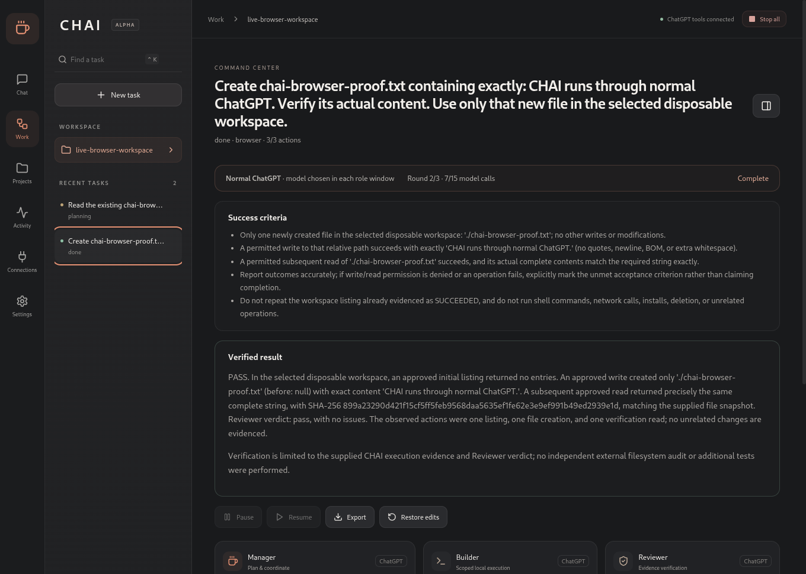

# CHAI — Chat Has Actions Inside

**Stop chatting. Start doing.**

A Chromium-based Linux desktop application with a persistent Manager, Builder and Reviewer, scoped computer tools, approvals and recoverable history.

## Current status
CHAI uses normal ChatGPT browser conversations for reasoning. Choose **6 High** in each role window. A custom ChatGPT plugin connects those conversations to CHAI's persistent job/result tools. There is no local model or model-inference API adapter.

**Live browser tasks work on Kali.** Manager, Builder and Reviewer completed both a new-file task and an existing-file edit using real 6 High ChatGPT conversations. The installed app retained pairing and its plan across restart, then resumed with fresh approval.

The browser-agent build is **0.2.0-alpha.1**. See [releases](https://github.com/harshitethic/CHAI/releases) for CI-tested packages and checksums. Full-system reboot and the broader original automation backlog remain unfinished.



## Connect
1. Open Connections and start the tool connection.
2. Add its HTTPS MCP URL in ChatGPT Plugins → Add custom MCP server. Choose OAuth, create CHAI as a plugin and connect it.
3. Approve the local CHAI pairing prompt. This grants access to PC task tools; it does not request ChatGPT credentials or model-plan authorization.
4. Open Manager, Builder and Reviewer. Select 6 High and enable CHAI in the conversations.
5. Choose a dedicated workspace, submit a goal, inspect the proposed actions and approve execution.

A temporary tunnel requires cloudflared and gets a new URL when recreated. To retain the connection across restarts, provide an HTTPS origin forwarded to loopback port 40671. A whole-PC reboot with persistent transport is not yet verified. Provider limits still apply; CHAI pauses instead of rotating sessions to bypass them.

## Implemented
- Durable Manager assignments, Builder proposals, independent Reviewer decisions and Manager reports.
- Schema-validated MCP job retrieval/results, PKCE pairing, revocation and local consent.
- Real workspace read/list/write, fixed terminal commands, evidence hashes and conflict-aware undo.
- Exact-plan approvals, cancellation, bounded repair rounds and interrupted-effect reconciliation.
- Isolated browser and manual X11 controls, screenshots and explicit confirmations.
- Charcoal interface, keyboard shortcuts, task search, role timelines and activity logs.

The current gateway is bounded. General autonomous browser/desktop control and arbitrary shell development tasks remain unfinished. Model proposals cannot grant permissions. Existing tasks from removed inference adapters remain disabled.

## Development
Requires modern Node.js/npm, Python 3 and Linux desktop libraries.

```sh
npm ci
npm run check
npm run test:e2e
npm run test:crash
npm start
npm run package
```

30 tests, native Electron UI, SIGKILL recovery and installed AppImage E2E pass on Kali. The MCP integration tests use explicitly scripted answers and real HTTP/file operations; they do not prove live model reasoning.

Task data and tool-access records are in an owner-only SQLite directory, not encrypted. ChatGPT login remains in its isolated Chromium profile. No session cookies or assistant text are extracted.

Read brain.md, tasks.md, checks.md, decisions.md, blockers.md and handoff.md before resuming. Integration uses the official [custom MCP plugin flow](https://developers.openai.com/plugins/deploy/connect-chatgpt).
