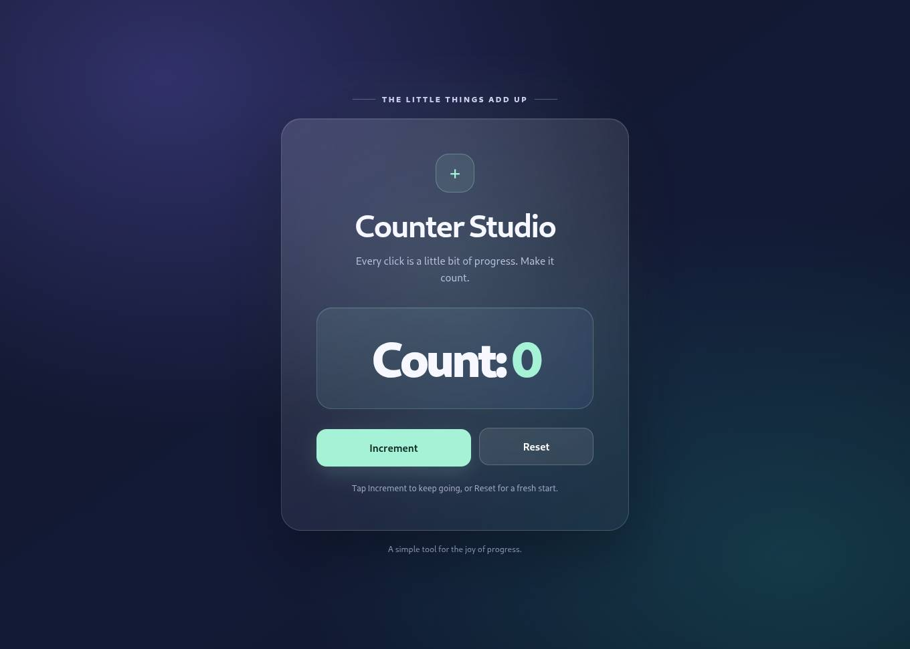

# CHAI — Chat Has Actions Inside

**Stop chatting. Start doing.**

A Chromium-based Linux desktop application with a persistent Manager, Builder and Reviewer, scoped computer tools, approvals and recoverable history.

## Current status
CHAI uses normal ChatGPT browser conversations for reasoning. Choose **6 High** in each role window. A custom ChatGPT plugin connects those conversations to CHAI's persistent job/result tools. There is no local model or model-inference API adapter.

**Live browser tasks work on Kali.** Manager, Builder and Reviewer completed both a new-file task and an existing-file edit using real 6 High ChatGPT conversations. The installed app retained pairing and its plan across restart, then resumed. In 0.3, a task workspace grant also covers later discovery and repair rounds.

**0.3 live verification:** ChatGPT inspected a broken Python function, created four tests, observed three failures, fixed the function and reran the same tests successfully. One workspace grant, seven role calls, zero manual plan approvals. [Execution evidence](docs/qa/autonomous-live-2026-10-19.json).

**0.4 live verification:** ChatGPT inspected a counter page, ran its Node test, opened it in CHAI's browser and used real Increment/Reset clicks. Screenshot-backed observations show **0 → 1 → 2 → 0**; independent review passed. Three rounds, ten role calls and one workspace grant. ChatGPT's own approval prompts were handled separately. [Evidence](docs/qa/computer-live-2026-10-19.json).



**0.5 live verification:** ChatGPT repaired a Python function, proved the unchanged test passed, inspected the selected diff and created a native-confirmed review commit. HEAD and the staging index stayed unchanged; an unrelated staged edit was preserved. [Evidence](docs/qa/git-live-2026-10-19.json).

The review-commit build is **0.5.0-alpha.1**. See [releases](https://github.com/harshitethic/CHAI/releases) for CI-tested packages and checksums. Full-system reboot and the broader original automation backlog remain unfinished.


## Connect
1. Open Connections and start the tool connection.
2. Add its HTTPS MCP URL in ChatGPT Plugins → Add custom MCP server. Choose OAuth, create CHAI Desktop as a plugin and connect it.
3. Approve the local CHAI pairing prompt. This grants access to PC task tools; it does not request ChatGPT credentials or model-plan authorization.
4. Open Manager, Builder and Reviewer. Select 6 High and enable CHAI Desktop in the conversations.
5. Choose a dedicated workspace, choose **Autonomous in this workspace**, and start the task. Starting grants reads, edits and isolated tests for that task. Use **Review each plan** if you prefer per-round approval.

Enable browser access separately to preview project pages or allow exact HTTPS origins. Select a disposable X11 application window separately for desktop screenshots and input. These observations are shared with ChatGPT. Git commits always require a separate native confirmation showing the exact selected-file patch, message and review branch.

A temporary tunnel requires cloudflared and gets a new URL when recreated. To retain the connection across restarts, provide an HTTPS origin forwarded to loopback port 40671. A whole-PC reboot with persistent transport is not yet verified. Provider limits still apply; CHAI pauses instead of rotating sessions to bypass them.

## Implemented
- Durable Manager assignments, Builder proposals, independent Reviewer decisions and Manager reports.
- Schema-validated MCP job retrieval/results, PKCE pairing, revocation and local consent.
- Real workspace read/list/write, nested directory creation, bounded literal search, fixed terminal commands, evidence hashes and conflict-aware undo.
- One workspace grant per task, per-plan review mode, revocation, cancellation and interrupted-effect reconciliation.
- Python, Node and Bash tests in Bubblewrap: selected input snapshots, read-only workspace, temporary outputs, no host network or credentials.
- Failed test evidence returns to Reviewer/Builder for repair; autonomous tasks allow up to 12 rounds, 60 role calls and 144 actions.
- Agent-driven isolated browser previews, observed-element clicks/typing/keys, screenshots, authorized HTTPS origins and sensitive-action confirmations.
- Selected-window X11 observations, clicks/typing/keys, screenshot coordinates and process/focus/geometry checks.
- Selected-file Git diffs and locally confirmed review-branch commits. Current branch and staging index are preserved; no push, repository hooks or signing commands.
- Charcoal interface, keyboard shortcuts, task search, role timelines and activity logs.

The current gateway is bounded. Arbitrary whole-desktop control, network/package installation and host shell development tasks remain outside the current bounded tools. Sandbox commands can run generated code but cannot mutate host files. Model proposals cannot grant permissions. Existing tasks from removed inference adapters remain disabled.

## Development
Requires modern Node.js/npm, Python 3, Bubblewrap (`/usr/bin/bwrap`), Git and Linux desktop libraries. Selected-window X11 control also requires xdotool and x11-utils. Sandboxed Node tests require `/usr/bin/node`. AppImage users must install these system dependencies; the Debian package declares them.

```sh
npm ci
npm run check
npm run test:computer
npm run test:e2e
npm run test:crash
npm start
npm run package
```

50 tests, browser interaction/X11 checks, native Electron UI, SIGKILL recovery and installed AppImage E2E pass on Kali. The MCP integration tests use explicitly scripted answers and real HTTP/file operations; they do not prove live model reasoning.

Selected workspace contents, task goals and execution evidence are sent to your ChatGPT conversations through the tool connection. Task data and tool-access records are in an owner-only SQLite directory, not encrypted. ChatGPT login remains in its isolated Chromium profile. No session cookies or assistant text are extracted.

Read brain.md, tasks.md, checks.md, decisions.md, blockers.md and handoff.md before resuming. Integration uses the official [custom MCP plugin flow](https://developers.openai.com/plugins/deploy/connect-chatgpt).


On Ubuntu hosts that restrict unprivileged user namespaces, Bubblewrap may fail with `RTM_NEWADDR: Operation not permitted`. CHAI refuses execution rather than dropping network isolation. An administrator should review the system's Bubblewrap/AppArmor profile using [Ubuntu's user-namespace guidance](https://discourse.ubuntu.com/t/understanding-apparmor-user-namespace-restriction/58007). CHAI does not change system policy automatically. CI grants `/usr/bin/bwrap` namespace access on the disposable runner only.
