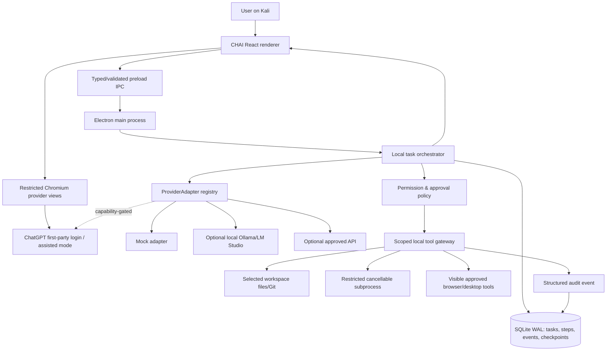

# CHAI Architecture — Implementation Blueprint

> This is the original architecture specification. The current shipped/source boundaries are documented in [IMPLEMENTATION.md](IMPLEMENTATION.md). Its historical local/mock/API-provider options are superseded by the user's normal-ChatGPT-only requirement.

## Design principle

**Chat views are user/model interfaces; the local orchestrator is the system of record.** No browser tab owns privileged tools, work state, approval policies or retry logic. A browser timeout must never delete the queue. No claim that a tab can act as a full autonomous model endpoint when provider support is absent.

## Component diagram



## Process security split

**Electron main process:** creates BrowserWindow(s), owns state machine, DB, shell tools and restricted native OS integration. Content cannot directly call privileged main functions. Use `WebContentsView` or supported equivalent over legacy/deprecated APIs on current Electron. Set `contextIsolation: true`, `sandbox: true`, `nodeIntegration: false`, `webSecurity: true`, `enableRemoteModule: false` where applicable. No `--no-sandbox` convenience flags in production.

**CHAI renderer:** packaged, signed/controlled local assets. Communicates over narrow versioned preload API (`chai.tasks.*`, `chai.tools.*`, etc.). No Node runtime. Strong CSP, no arbitrary remote `<script>` or eval. Sanitize Markdown/code HTML and prevent XSS.

**Provider webview:** origin-restricted first-party `https://chatgpt.com` browsing with no preload privilege, no arbitrary navigation into CHAI internals, no IPC access, no cookie extraction or password interception. OAuth/login behavior may reject embedding; handle transparently using approved external-browser login or manual session status. Avoid provider session import hacks.

**Tool executor:** receives only approved normalized `ToolRequest` shapes. Restricts resources to actual selected workspace and granted host capabilities, with timeouts, cancellation, redaction and signed/logged approval decisions.

**Background behavior:** on closing UI, default **pause** (safe UX) until a separate explicit preference says “continue approved local tasks in background”. If enabled, main process remains accessible through a tray icon, monitors `Stop All`, never executes unapproved risk categories and is stopped on logout / system shutdown.

## Storage schema (starting point)

```sql
CREATE TABLE task (
  id TEXT PRIMARY KEY,
  title TEXT NOT NULL,
  goal TEXT NOT NULL,
  state TEXT NOT NULL,
  workspace_root TEXT NOT NULL,
  provider_mode TEXT NOT NULL,
  plan_version INTEGER NOT NULL DEFAULT 0,
  created_at TEXT NOT NULL,
  updated_at TEXT NOT NULL
);
CREATE TABLE step (
  id TEXT PRIMARY KEY,
  task_id TEXT NOT NULL REFERENCES task(id),
  role TEXT NOT NULL,
  title TEXT NOT NULL,
  state TEXT NOT NULL,
  prerequisites_json TEXT NOT NULL,
  attempt INTEGER NOT NULL DEFAULT 0,
  idempotency_key TEXT UNIQUE,
  started_at TEXT,
  finished_at TEXT
);
CREATE TABLE event (
  id TEXT PRIMARY KEY,
  task_id TEXT NOT NULL REFERENCES task(id),
  step_id TEXT,
  kind TEXT NOT NULL,
  payload_redacted_json TEXT NOT NULL,
  created_at TEXT NOT NULL
);
CREATE TABLE approval (
  id TEXT PRIMARY KEY,
  task_id TEXT NOT NULL REFERENCES task(id),
  step_id TEXT,
  capability TEXT NOT NULL,
  resource TEXT NOT NULL,
  decision TEXT NOT NULL,
  expires_at TEXT,
  created_at TEXT NOT NULL
);
CREATE TABLE checkpoint (
  id TEXT PRIMARY KEY,
  task_id TEXT NOT NULL REFERENCES task(id),
  plan_version INTEGER NOT NULL,
  state_json TEXT NOT NULL,
  created_at TEXT NOT NULL
);
CREATE TABLE worker_lease (
  worker_id TEXT PRIMARY KEY,
  task_id TEXT,
  step_id TEXT,
  lease_token TEXT,
  expires_at TEXT
);
```

This is schematic, not production-ready SQL. Add migrations, indices, referential integrity, serialized writes, transaction boundaries, size limits, retention/privacy settings, and event schema versions before release. Avoid plain-text secrets in event payloads.

## Main services and ownership

| Service | Responsibilities | Must never do |
| --- | --- | --- |
| TaskService | create, pause, cancel, resume, list | silently run actions |
| Planner | propose plan and acceptance criteria | approve own privileged tools |
| Scheduler | dependency graph, leases, retries | infinitely retry provider limits |
| ProviderRegistry | capabilities, availability, adapter modes | present browser login as API key |
| ToolPolicy | grants, resource checks, approval state | trust unverified LLM text as grants |
| ToolRunner | execute bounded host action, record proof | run unscoped shell as root |
| StateStore | transactional persistence, recovery | store scraped session cookies |
| AuditService | append provenance, redact, export | leak sensitive stdout by default |
| DesktopHost | windows, tray, notifications, settings | let webview access OS primitives |

## Worker communication model

The Manager submits `WorkOrder` objects (step ID, goal, constraints, tool capabilities, success checks, expected artifacts). Builder/Reviewer produce `WorkResult` (claim, evidence IDs, changes, test outputs, risks, next step). All results return through local dispatcher and are stored durably. A reviewer cannot simply approve a claim without accessing evidence.

**Example:** `Please add a health-check endpoint to my selected local project.` Manager creates discovery step → Builder reads allowed files → Builder proposes patch → gateway creates backup and applies in workspace → test runner runs project's existing suite with approval → Reviewer checks diff and test result → Manager closes task with exact paths/commands. All side effects uniquely identified to avoid duplicate writes on retry.

## Concurrency rules

- Single writer per workspace for file mutations. Multiple read-only steps can proceed concurrently.
- Worker leases expire and may be reclaimed only after checking prior side effects.
- Store `plan_version` and enforce optimistic updates before worker state changes.
- All tool actions carry request IDs, idempotency keys, source role and permission decision ID.
- Reviewer cannot mutate the same files as Builder during review unless Manager generates a separate patch task.
- Provider failures put affected steps in `WAITING_PROVIDER`, not `DONE`.

## Crash recovery

On app boot:

1. Open DB, run safe migrations/backups; validate task schemas.
2. Recover all tasks in `RUNNING` states by reconciling step/tool events.
3. Mark abandoned leases stale only after expiry; inspect whether external effects committed.
4. For idempotent read-only actions, retry within budget; for writes, compare snapshot/patch hash and ask to reconcile ambiguous partial state rather than reapply.
5. If no provider is available, persist `WAITING_PROVIDER` and notify user (never busy-loop).
6. Restore UI to last selected task and timeline; do not overwrite source from stale plan.

## Observability

Append structured events with UTC timestamps and stable identifiers. Show a readable per-task timeline, worker status, diff/command stdout excerpts, approvals, errors, and exported diagnostics (redact secrets/path components where appropriate). Make debug telemetry **local only by default**. Never add analytics without opt-in disclosure.

## Performance guardrails

- Virtualize long logs and conversations; limit event UI rendering.
- Lazy-load worker webviews; allow suspension of unused views; cache no sensitive DOM snapshots.
- Bound concurrent tools and worker tasks. No dozens of Chrome processes to evade usage caps.
- Memory/startup measurements from actual Kali; adjust when observed, not guessed.
