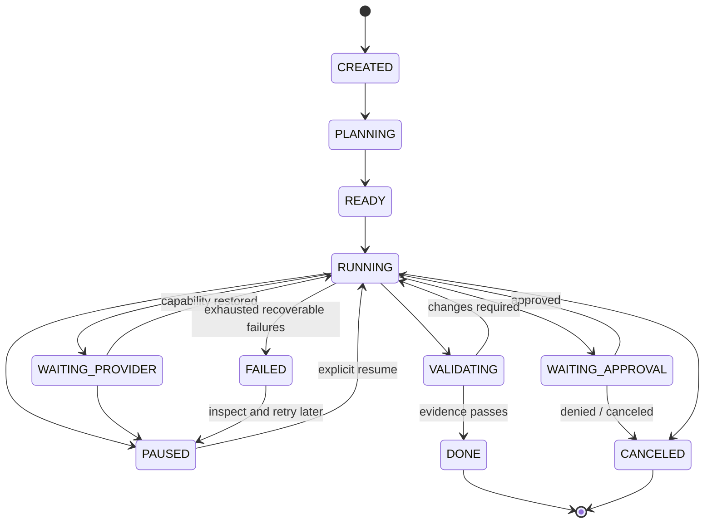

# State and Message Protocol (Implementation Contract)

## State graph



`RUNNING` does not mean provider always active; actual step states are authoritative. On app restart any `RUNNING` task goes into reconciliation before new side effects.

## Suggested types (illustrative; finalize with Zod validators)

```ts
type Role = 'manager' | 'builder' | 'reviewer';
type ProviderMode = 'mock' | 'local' | 'official-api' | 'interactive-web' | 'compliant-web';
type TaskState =
  | 'CREATED' | 'PLANNING' | 'READY' | 'RUNNING'
  | 'WAITING_APPROVAL' | 'WAITING_PROVIDER' | 'PAUSED'
  | 'VALIDATING' | 'DONE' | 'FAILED' | 'CANCELED';
type RiskLevel = 'READ' | 'SAFE_WRITE' | 'EXEC' | 'SENSITIVE' | 'IRREVERSIBLE';

interface WorkOrder {
  schemaVersion: 1;
  id: string;
  taskId: string;
  stepId: string;
  planVersion: number;
  role: Role;
  objective: string;
  constraints: string[];
  workspaceId: string;
  allowedCapabilities: string[];
  evidenceRequirements: string[];
  parentStepIds: string[];
  createdAt: string;
}
interface WorkResult {
  schemaVersion: 1;
  orderId: string;
  stepId: string;
  role: Role;
  status: 'COMPLETED' | 'NEEDS_APPROVAL' | 'BLOCKED' | 'FAILED';
  summary: string;
  evidenceIds: string[];
  proposedToolRequests: string[];
  warnings: string[];
  finishedAt: string;
}
interface ToolRequest {
  id: string;
  taskId: string;
  stepId: string;
  idempotencyKey: string;
  toolName: string;
  riskLevel: RiskLevel;
  workspaceId: string;
  input: unknown; // parse with tool-specific Zod schema
  requestedBy: Role;
}
interface ToolResult {
  toolRequestId: string;
  status: 'SUCCEEDED' | 'FAILED' | 'DENIED' | 'CANCELED' | 'UNKNOWN';
  exitCode?: number;
  redactedOutput: string;
  evidenceIds: string[];
  approvalId?: string;
  completedAt: string;
}
```

## Durable event envelope

```json
{
  "schemaVersion": 1,
  "eventId": "uuid-v4",
  "taskId": "task-uuid",
  "stepId": "step-uuid",
  "actor": "builder",
  "type": "TOOL_EXECUTED",
  "source": "local-tool-gateway",
  "correlationId": "work-order-uuid",
  "timestamp": "2026-10-19T05:00:00Z",
  "payload": { "tool": "workspace.writePatch", "result": "SUCCEEDED", "evidenceId": "evidence-uuid" }
}
```

Example only: runtime IDs/timestamps must be generated, never reused as actual evidence.

## Transaction / idempotency approach

- Use unique key per planned tool mutation, stored **before** executing action.
- On retry: check prior `SUCCEEDED` result and artifact digest; return prior result when exact inputs match.
- On ambiguous crash during side effect: `UNKNOWN` status; verify effect exists or ask user, do not unconditionally retry.
- Mark completion only if success criteria met with evidence IDs. Model prose alone is not proof.
- Each worker result references current plan version to reject stale late responses.

## Provider capability handshake

```ts
interface ProviderCapabilities {
  provider: string;
  mode: ProviderMode;
  userAuthenticated: boolean;
  canSendProgrammatically: boolean;
  canReceiveProgrammatically: boolean;
  canSelectModel: boolean;
  canSelectEffort: boolean;
  canStream: boolean;
  canResumeConversation: boolean;
  limits?: { kind: 'rate' | 'quota' | 'session'; retryAfterSeconds?: number };
}
```

When `canSendProgrammatically` is false the app **must not silently pretend the manager can send work to a ChatGPT tab**. Show Assisted mode and actionable next step. Mock/local workers still demonstrate the orchestration engine without deception.

## Failure taxonomy

`AUTH_REQUIRED`, `PROVIDER_LIMIT`, `PROVIDER_UNSUPPORTED`, `PROVIDER_TIMEOUT`, `WORKSPACE_DENIED`, `TOOL_DENIED`, `TOOL_TIMEOUT`, `TOOL_FAILED`, `FAILED_VALIDATION`, `CRASH_RECOVERY_AMBIGUOUS`, `DATA_MIGRATION_ERROR`.

Each error has human-readable explanation, retriable flag, safe next action, relevant event IDs and (when appropriate) `retryAfter`. Never retry `WORKSPACE_DENIED` by broadening path; never retry `AUTH_REQUIRED` by accessing browser credentials.
